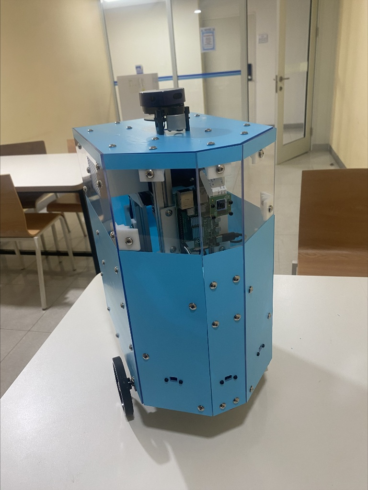
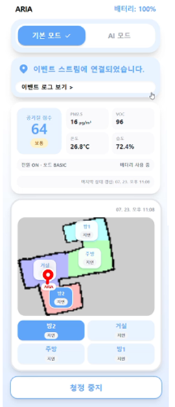
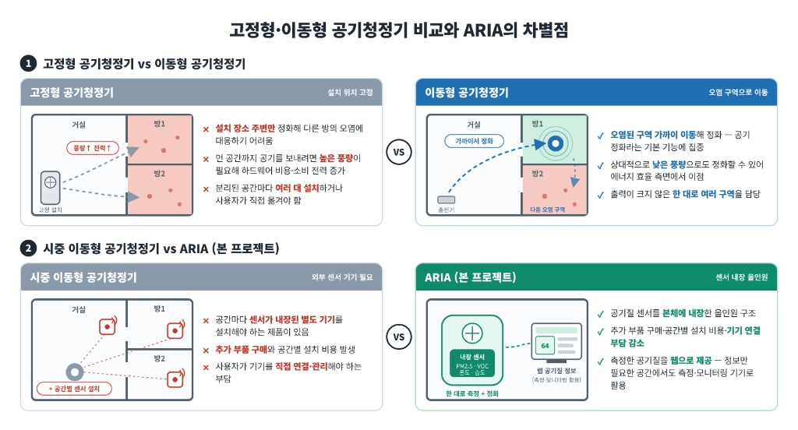
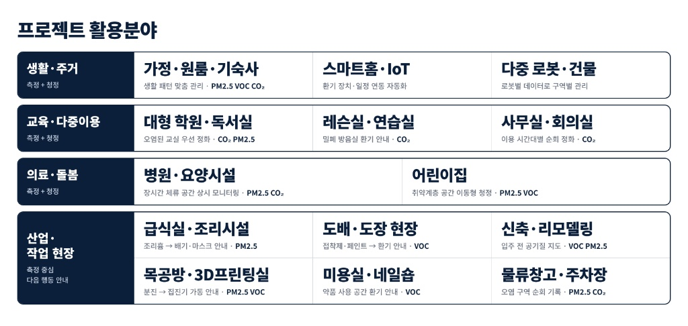
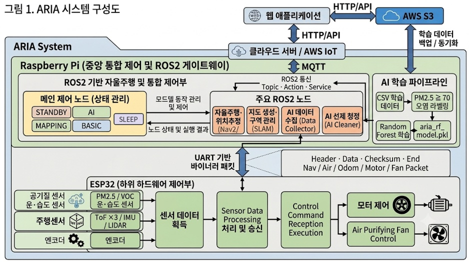
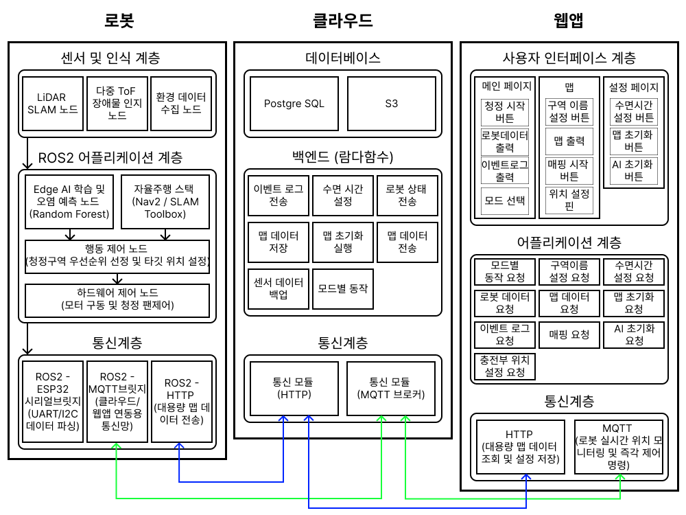
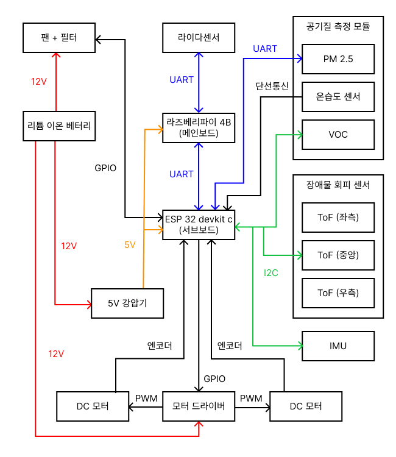
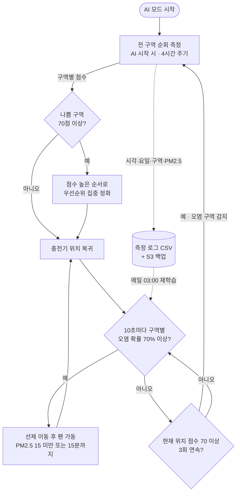

# ARIA: AI 기반 자율주행 로봇 공기청정기

## 💡1. 프로젝트 개요

### 1-1. 프로젝트 소개
- **프로젝트 명** : ARIA (AI-based Robotic Indoor Air purifier)
- **프로젝트 정의** : 라이다·공기질 센서·경량 AI를 탑재해 실내 공간을 자율주행하며, 구역별 오염을 측정하고 예측해 선제적으로 정화하는 가정용 이동형 공기청정 로봇

<p align="center">


</p>

### 1-2. 개발 배경 및 필요성
- 고정형 공기청정기는 설치 위치 주변만 정화할 수 있어, 넓은 거실이나 떨어진 방에는 사각지대가 생깁니다.
- 대부분의 제품은 오염이 감지된 **뒤에** 반응합니다. 그런데 요리·청소처럼 생활 오염은 매일 비슷한 시간대에 반복되는 경우가 많아, 패턴을 알면 미리 대응할 수 있습니다.
- 기존 이동형·연동형 제품 중에는 별도 외부 센서 설치나 구독형 서비스가 필요한 경우가 있어 도입 부담이 있습니다.
- 따라서 **센서를 본체에 내장한 단일 기기**로 집 안을 돌며 구역별 공기질을 직접 측정하고, 오염 시간대를 학습해 **선제적으로 이동·정화**하는 로봇이 필요합니다.

### 1-3. 프로젝트 특장점

- **구역 단위 공기 관리** : 지도를 방·주방·거실 등 구역으로 자동 분할하고, 구역별로 측정·등급화·정화합니다.
- **오염 예측 기반 선제 정화** : 구역마다 "이 시간대에 오염될 확률"을 예측해, 오염이 확산되기 전에 해당 구역으로 이동합니다.
- **예측 밖 오염에도 대응** : 예측에 없던 오염이 감지되면 즉시 전 구역을 탐색해 점수를 매기고, 오염이 심한 구역부터 정화한 뒤 충전기로 돌아옵니다.
- **스스로 개선되는 모델** : 로봇이 순회하며 쌓은 측정 데이터로 매일 새벽 모델을 재학습하고, 재시작 없이 즉시 반영합니다.
- **이기종 분산 제어** : 라즈베리파이(SLAM·자율주행·AI)와 ESP32-S3(센서 수집·모터·팬 실시간 제어)를 분리하고, 체크섬이 포함된 바이너리 패킷으로 통신합니다.
- **센서 내장형 단일 기기** : PM2.5·VOC·온습도 센서를 본체에 내장해 별도 설치 없이 동작합니다.
- **라이다 + ToF 이중 장애물 인식** : 상단 라이다와 하단 ToF 3개를 함께 써서, 라이다가 놓치는 낮은 장애물까지 피합니다.
- **사용자 생활 패턴 반영** : 웹앱에서 설정한 수면 시간에는 취침 모드로 전환해 모든 동작을 멈추고, 기상 시각에 취침 전 모드로 자동 복귀합니다. 판단은 로봇이 로컬 시계로 하므로 네트워크가 끊겨도 동작합니다.

### 1-4. 주요 기능
- **자동 매핑** : 탐사 알고리즘(explore_lite)과 SLAM Toolbox로 집 안 지도를 스스로 작성하고, 끝나면 도킹 위치로 복귀합니다.
- **구역 자동 분할** : 완성된 지도에 Distance Transform + Watershed를 적용해 구역을 나누고, 각 구역의 중심점을 이동 목표로 등록합니다.
- **AI 모드**
  - *순회 측정* : AI 모드를 켜면 바로, 이후 4시간마다 모든 구역을 돌며 공기질 점수를 측정·기록합니다. 구역별 점수는 실시간 로그로, 4단계(좋음·보통·나쁨·지연) 등급은 웹앱 지도에 표시합니다.
  - *우선순위 집중 정화* : 순회 결과 "나쁨"(70점 이상) 구역을 점수가 높은 순서로 방문해, 팬을 최대로 가동하며 공기가 회복될 때까지 머뭅니다. 정화가 끝나면 충전기 위치로 복귀합니다.
  - *예측 선제 정화* : 순회 사이 시간에는 10초마다 구역별 오염 확률을 계산해, 70%를 넘는 구역이 있으면 미리 이동해 정화합니다.
  - *예측 밖 오염 대응* : 대기 중 로봇 위치의 공기질 점수가 70점 이상으로 3회(약 6초) 연속 측정되면 "오염 구역 감지"로 판단하고, 즉시 순회 → 우선순위 정화 → 충전기 복귀를 수행합니다.
- **기본 모드** : 웹앱에서 구역을 선택하면 그 구역으로 이동해 팬을 최대로 가동하고, 공기질이 양호해질 때까지 머문 뒤 대기 상태로 돌아갑니다.
- **취침 모드** : 사용자가 설정한 수면 시각이 되면 현재 모드를 저장하고 이동·정화·팬을 모두 멈춥니다. 기상 시각이 되면 저장해 둔 취침 전 모드로 자동 복귀합니다.
- **웹앱** : QR 로그인, 실시간 위치가 표시되는 지도, 구역별 공기질 등급, 모드 제어, 수면 시간 설정, 실시간 동작 로그·이벤트 기록을 제공합니다.

### 1-5. 기대 효과 및 활용 분야

- **기대 효과**
  - 로봇 1대로 실내 전 구역을 관리해 고정형 제품의 사각지대 문제를 줄입니다.
  - 오염 발생 전 선제 정화로, 오염이 집 전체로 퍼지는 것을 줄입니다.
  - 센서 내장 단일 기기로 설치 부담과 비용을 낮춥니다.
- **활용 분야** : 가정, 소규모 사무실, 어린이집·학원 등 실내 공간. 정화 기능을 제외하고 측정·순회 기능만 사용하면 급식실·매장 등 다중 공간의 **공기질 순찰 로봇**으로도 활용할 수 있습니다.

### 1-6. 기술 스택
- **운영 환경** : Ubuntu 22.04 LTS, ROS2 Humble, PlatformIO, Git/GitHub
- **하드웨어** : Raspberry Pi 4B, ESP32-S3 DevKitC-1, Cytron 모터 드라이버, 엔코더 DC 모터 2개, PWM 팬
- **센서** : YDLidar X2(라이다), PMS 계열(PM2.5), SGP40(VOC), DHT22(온습도), VL53L0X ×3(ToF), MPU9250(IMU)
- **자율주행** : SLAM Toolbox(async), AMCL, Nav2(A* 전역 경로 + DWB 지역 제어), explore_lite
- **AI/데이터** : scikit-learn(Random Forest), pandas, OpenCV·scikit-image(구역 분할), cron 야간 재학습
- **펌웨어** : C++(Arduino on ESP32-S3), UART 바이너리 패킷 통신
- **백엔드** : AWS Lambda(Python), Node.js(Express)
- **데이터베이스** : PostgreSQL + TimescaleDB
- **클라우드** : AWS IoT Core(MQTT, Device Shadow), API Gateway, Amazon S3
- **프론트엔드** : React, TypeScript, Vite, Tailwind CSS, Zustand, Axios

---

## 💡2. 팀원 소개(이름 기재X)

|  |  |  |  |  |
|:---:|:---:|:---:|:---:|:---:|
| **멘티1** | **멘티2 (팀장)** | **멘티3** | **멘티4** | **멘토** |
| • AWS IoT·클라우드 백엔드·API·DB <br> • MQTT 연동 | • 팀 통합 관리 <br> • ESP32 센서·팬 제어 <br> • 구역 분할 알고리즘 및 로봇 통합 시험 | • ROS2·Raspberry Pi 환경, 펌웨어 통합 <br> • AI 데이터 수집·자동 학습 파이프라인 | • React 웹 애플리케이션 <br> • 지도·로봇 위치 시각화, API 연동 및 UI 통합 테스트 | • 프로젝트 멘토 <br> • 기술 자문 |

---

## 💡3. 시스템 구성도

### 3-1. 전체 아키텍처
로봇 내부(라즈베리파이 + ESP32-S3), 클라우드(AWS), 웹앱의 3계층으로 구성됩니다. 로봇과 웹앱은 AWS IoT Core를 사이에 두고 MQTT와 Device Shadow(desired/reported)로 상태를 동기화합니다.


### 3-2. S/W 구성도 (로봇–클라우드–웹)


### 3-3. H/W 구성도 (이기종 분산 제어)


**UART 바이너리 패킷 (115200bps)** — 공통 구조 `[Header 2B][ID 1B][Payload][Checksum 1B][Tail 2B]`
패킷 길이는 ID별로 고정되어 있어, 수신 측은 ID로 길이를 판단하고 체크섬으로 무결성을 검사합니다.

### 3-4. 서비스 흐름도 (AI 모드)



---

## 💡4. 작품 소개영상

[](https://youtu.be/aaa0t_gYd8A)

---

## 💡5. 핵심 소스코드

### 5-1. 오염 여부 라벨링과 야간 학습
- **파일 위치** : `ai_pipeline/scripts/night_training.py`
- **소스코드 설명** : 오염이 발생한 기록만이 아니라 전체 순회 기록에 오염 여부 라벨을 붙여, 구역별로 "이 시간대에 오염되는가"를 학습하는 부분입니다.
```python
# 전체 행에 오염 여부 라벨을 붙인다(오염 행만 고르지 않는다).
df['polluted'] = (df['pm25'] >= POLLUTION_THRESHOLD).astype(int)

def build_features(df, zones):
    minutes = df['hour'] * 60 + df['minute']
    feats = pd.DataFrame({
        'tod_sin': np.sin(2 * math.pi * minutes / 1440.0),   # 23시와 0시가 가깝도록
        'tod_cos': np.cos(2 * math.pi * minutes / 1440.0),
        'dow_sin': np.sin(2 * math.pi * df['day_of_week'] / 7.0),
        'dow_cos': np.cos(2 * math.pi * df['day_of_week'] / 7.0),
    })
    for z in zones:                                          # 구역 one-hot
        feats[f'zone={z}'] = (df['zone_name'] == z).astype(int)
    return feats

model = RandomForestClassifier(n_estimators=50, max_depth=6, min_samples_leaf=3,
                               class_weight='balanced', random_state=42)
model.fit(build_features(df, zones), df['polluted'])
```

### 5-2. 구역별 오염 확률 예측과 선제 이동
- **파일 위치** : `robot/src/my_robot_ai_control/my_robot_ai_control/ai_cleaner_node.py`
- **소스코드 설명** : 등록된 구역마다 오염 확률을 따로 계산하고, 70%를 넘는 구역이 있을 때만 가장 확률이 높은 구역으로 선제 이동하는 부분입니다.
```python
def predict_zone_probs(self, now):
    rows = pd.DataFrame([{'hour': now.hour, 'minute': now.minute,
                          'day_of_week': now.weekday(), 'zone_name': z} for z in known])
    X = build_features(rows, self.bundle['feature_columns'])
    probs = self.bundle['model'].predict_proba(X)[:, 1]      # 구역별 P(오염)
    return dict(zip(known, probs))

candidates = {z: p for z, p in probs.items()
              if p >= self.threshold and not self._in_cooldown(z)}
if candidates:
    target, prob = max(candidates.items(), key=lambda kv: kv[1])
    self.send_navigation_goal(target)                        # 오염 전 선제 이동
```

### 5-3. ESP32 ↔ 라즈베리파이 바이너리 패킷
- **파일 위치** : `firmware/esp32/src/main.cpp`
- **소스코드 설명** : 구조체를 1바이트 단위로 정렬(`#pragma pack`)해 그대로 전송하는 패킷 정의와 체크섬 계산 부분입니다. 수신 측은 헤더 동기화 → ID별 길이 확인 → 체크섬 검증 순으로 파싱합니다.
```cpp
#pragma pack(push, 1)
struct AirPacket {
    uint16_t header = 0xAA55;
    uint8_t  id     = 1;
    float pm25;
    float voc;
    float temperature;
    float humidity;
    uint8_t  checksum;
    uint16_t tail = 0x0A0D;
};                                   // 총 22바이트
#pragma pack(pop)

uint8_t calculateChecksum(uint8_t* data, size_t len) {
    uint8_t sum = 0;
    for (size_t i = 0; i < len - 3; i++) sum += data[i];   // 체크섬·꼬리 제외 합
    return sum;
}
```
